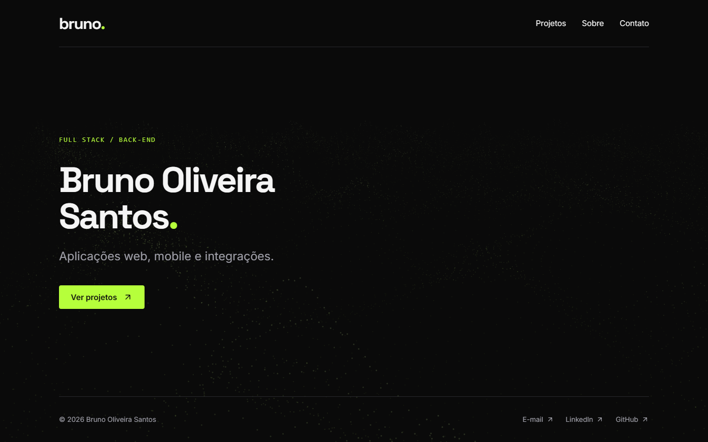

# Meu portfólio

Projeto do meu portfólio pessoal, onde apresento um pouco sobre mim, meus projetos e formas de contato.

Feito com Next.js, React, TypeScript e Tailwind CSS.



## Rodar localmente

Node.js 22.12 ou superior.

```bash
npm ci
npm run dev
```

Abra `http://localhost:3000`.

[Licença MIT](LICENSE).
