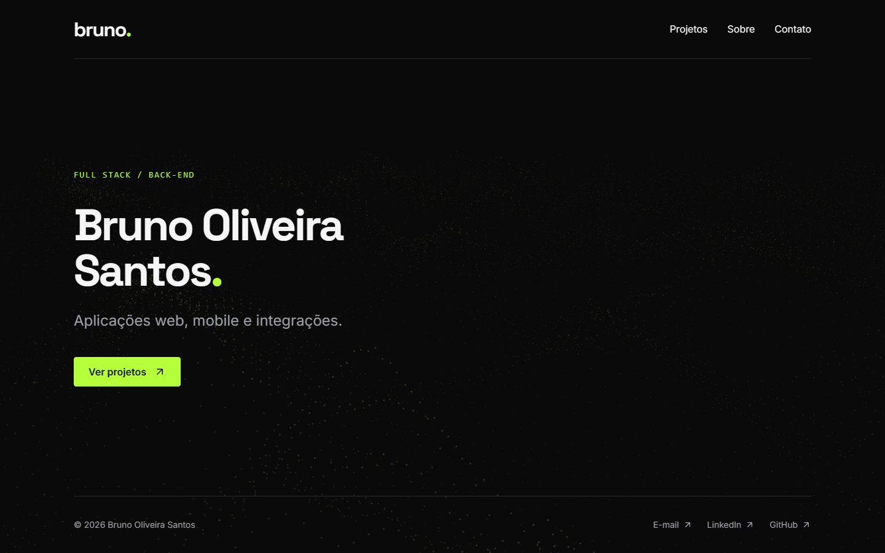

# Meu portfólio

Projeto do meu portfólio pessoal, onde apresento um pouco sobre mim, meus projetos e formas de contato.

Feito com Next.js, React, TypeScript e Tailwind CSS.



## Rodar localmente

Node.js 22.12 ou superior.

```bash
npm ci
npm run dev
```

Abra `http://localhost:3000`.

## Atualizar o currículo

Os dados do PDF ficam em `scripts/resume.json`. Após editá-los, gere novamente o arquivo disponibilizado no site:

```bash
python -m pip install reportlab
python scripts/generate-resume.py
```

O resultado é salvo em `public/curriculo-bruno.pdf`. Mantenha também os textos de `src/data/portfolio.ts` alinhados ao currículo.

[Licença MIT](LICENSE).
